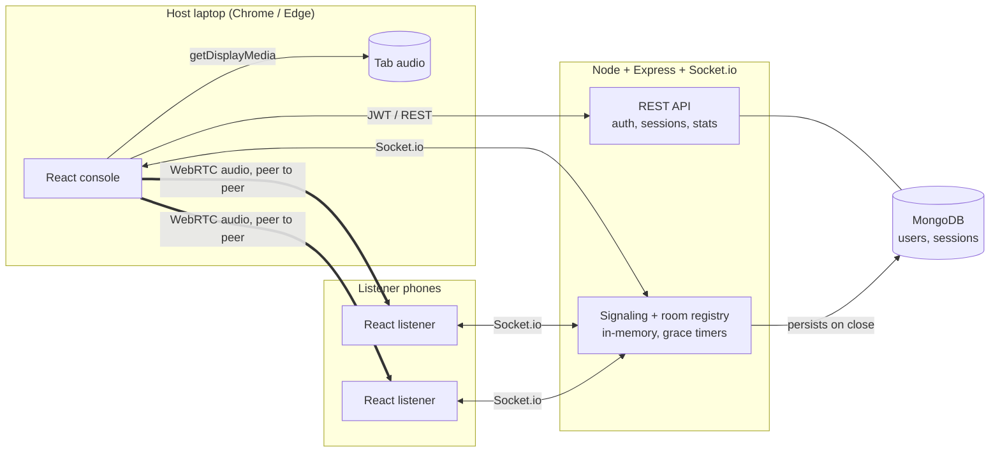

# SoundCircle

**Turn one laptop into everyone's headphones.** SoundCircle streams a laptop's audio live to every phone in the room through a 4-digit code. No app to install, no cables, no pairing.

- **Live app:** `https://soundcircle-mern.vercel.app`
- **API health check:** `https://soundcircle-mern.onrender.com/api/health`
- **Demo video:** [Watch on Google Drive](https://drive.google.com/file/d/1ETyW3utsifKjo1dIVd5lA__2ud4zMgKO/view?usp=drivesdk)
- **Repository:** `https://github.com/arif04102007/soundcircle-mern`

> **Origin note.** This is a ground-up MERN rebuild of my earlier SoundCircle/VibeSync prototype (a client-only React app with an in-memory Socket.io server and Supabase auth). The v2 backend, database, authentication, session history, reconnection handling, tests and UI are all new. Only the general WebRTC signaling idea carried over.

## Problem statement

Sharing audio in a group is awkward. Everyone crowds around one laptop speaker, or you need Bluetooth splitters and cables, or every person has to install an app and create an account. Silent discos, hostel movie nights, group study playlists and shared-TV viewing all hit the same wall: *one device is playing, many people want it in their own headphones.*

## Target users

- **Hosts:** a student, flatmate or event organiser with a laptop that is playing the audio (movie, playlist, lecture).
- **Listeners:** anyone with a phone and headphones. Listeners need no account and no install.

## Solution

The host signs in, opens a room and gets a 4-digit code. They share a browser tab's audio with one click. Listeners open the site on their phone, type the code, and hear the audio live over WebRTC. The host sees who is connected and how healthy each connection is, and every session is saved to a history dashboard.

## Key features (the workflows)

1. **Host accounts (JWT + bcrypt).** Register and sign in. Rooms and history belong to the host; listeners are anonymous.
2. **Open a room and go live.** Capture a tab's audio with `getDisplayMedia` (or the microphone as a fallback), tuned for music (stereo Opus, high bitrate). Audio is streamed peer-to-peer to every listener.
3. **Join with a code.** Listeners enter the 4-digit code (or scan the QR / open the link). They get a live level meter, volume control, connection status, emoji reactions and a "tap to start audio" prompt where browsers block autoplay.
4. **Reliability.** The room survives a host page refresh or a network blip: the host has a 30-second grace window to return, listeners see "host lost connection", and audio is renegotiated with an ICE restart. If the host doesn't return the room closes cleanly and everyone is told why.
5. **Studio dashboard.** Persistent session history in MongoDB: duration, time on air, unique listeners, peak crowd, reactions, why it ended, a 14-day listeners chart and lifetime totals. Hosts can delete past sessions.

## Tech stack

| Layer | Technology |
| --- | --- |
| Frontend | React 18, Vite, React Router, Tailwind CSS v4, Web Audio API (live level meters) |
| Realtime | WebRTC (audio), Socket.io (signaling, presence, reactions) |
| Backend | Node.js, Express, Socket.io |
| Database | MongoDB with Mongoose (Atlas in production) |
| Auth and security | JWT, bcryptjs, helmet, CORS allow-list, express-rate-limit, zod validation |
| Testing | `node:test` end-to-end suite (REST + Socket.io against a real database) |
| Hosting | Vercel (client), Render (server), MongoDB Atlas (database) |

## Architecture



**Key decisions**

- **Audio never touches the server.** The server only relays SDP/ICE messages (and only between sockets in the same room), so hosting is cheap and latency stays low. A TURN relay is used only when a direct path is impossible.
- **Open rooms live in memory; history lives in MongoDB.** A room is ephemeral state that must be fast, while a *session* is a durable record. A `Session` document is created when a room opens and finalised when it closes. On boot, any session still marked `active` is marked `interrupted`, so a crash never leaves a ghost room.
- **One open room per host.** Re-opening (refresh, second tab) re-attaches to the same room instead of creating a duplicate; the older tab is told it was taken over.
- **Rooms are protected from code guessing.** There are only 10,000 codes, so wrong guesses are rate limited per IP on both the socket join and the REST lookup.
- **Signaling is order-safe.** Offers, answers and ICE candidates are applied through a per-connection queue, and candidates that arrive early are buffered. This avoids the classic lost-candidate bug.

```
server/src
  index.js          boot, DB connect, orphan cleanup, graceful shutdown
  app.js            Express app, middleware, routes
  routes/           auth.js, sessions.js (history + stats), rooms.js (public lookup, ICE config)
  sockets/          index.js (rooms, signaling, grace timers, persistence), roomStore.js
  models/           User.js, Session.js
  middleware/       auth.js (JWT), error.js (uniform JSON errors)
client/src
  pages/            Landing, About, Auth, Studio, HostRoom, ListenerRoom
  hooks/            useHostRoom, useListenerRoom (WebRTC), useLevel (audio meter), rtc helpers
  context/          AuthContext, Toast
```

## API summary

| Method | Route | Auth | Purpose |
| --- | --- | --- | --- |
| POST | `/api/auth/register`, `/api/auth/login` | none | Create account / sign in (returns JWT) |
| GET | `/api/auth/me` | JWT | Current user |
| GET | `/api/room/:code` | none (rate limited) | Public room lookup |
| GET | `/api/config/ice` | none | ICE (STUN/TURN) servers |
| GET | `/api/sessions` | JWT | Paginated history for the signed-in host |
| GET | `/api/sessions/stats` | JWT | Lifetime totals and 14-day series |
| GET / DELETE | `/api/sessions/:id` | JWT + owner | One session / delete (403 for other users, 409 if still open) |

Socket events: `host:create`, `host:live`, `host:end`, `listener:join`, `listener:leave`, `listener:latency`, `signal` (relay), `reaction`, plus server events `room:live`, `room:count`, `room:host_status`, `room:closed`, `room:taken_over`.

## Error handling

Invalid input (400 with a field message), duplicate email (409), wrong credentials (401, same message for unknown email and wrong password), expired or missing token (401, client signs out), another user's session (403), missing session (404), deleting an open session (409), malformed JSON, rate limiting (429 / `RATE_LIMITED`), wrong or ended room code, host disconnect, listener reconnect, blocked autoplay, cancelled screen share, a shared tab without audio, unsupported browser, unreachable server, and failed history load (with retry). Loading skeletons, empty states and error states exist on every data screen.

## Security

Passwords are hashed with bcrypt and never returned by the API. JWT secret, database URI and TURN credentials live in environment variables (`.env` is git-ignored; `.env.example` lists names only). All input is validated with zod, room titles and names are sanitised, reactions are allow-listed, CORS is restricted to the deployed frontend, helmet sets security headers, and session history is scoped to its owner on every query.

## Local setup

Requires Node 18+ and a MongoDB database (a free Atlas cluster, or a local `mongod`).

```bash
git clone https://github.com/arif04102007/soundcircle-mern.git && cd soundcircle-mern

# 1) API
cd server
cp .env.example .env      # fill in MONGODB_URI and JWT_SECRET
npm install
npm run dev               # http://localhost:3001

# 2) Web app (new terminal)
cd client
cp .env.example .env      # VITE_API_URL=http://localhost:3001
npm install
npm run dev               # http://localhost:5173
```

To try it on one machine, open the app in two browser windows: host in one, listen in the other (use headphones, or mute one window, to avoid feedback). To try it with a phone, open the app on the laptop via your LAN IP, and set `CLIENT_ORIGIN` to include that origin.

**Run the tests** (needs `MONGODB_URI` pointing at a *disposable* database, e.g. `.../soundcircle_test`; the suite clears its users and sessions):

```bash
cd server && MONGODB_URI="mongodb://127.0.0.1:27017/soundcircle_test" npm test
```

## Environment variables

**server/.env**

| Name | Required | Description |
| --- | --- | --- |
| `MONGODB_URI` | yes | MongoDB connection string |
| `JWT_SECRET` | yes | Long random string (32+ chars in production) |
| `CLIENT_ORIGIN` | production | Comma-separated allowed frontend origins, e.g. `https://soundcircle-mern.vercel.app` |
| `PORT` | no | Defaults to 3001 (set automatically on Render) |
| `TURN_URLS`, `TURN_USERNAME`, `TURN_CREDENTIAL` | no | Your own TURN server; otherwise a public relay is used |

**client/.env**

| Name | Description |
| --- | --- |
| `VITE_API_URL` | Base URL of the deployed API (no trailing slash) |

## Deployment

1. **MongoDB Atlas:** create a free cluster and a database user, then allow network access from `0.0.0.0/0` (Render's free tier has no fixed IP). Copy the connection string.
2. **Render (API):** New Web Service from this repo, root directory `server`, build `npm install`, start `npm start` (or use `render.yaml`). Set `MONGODB_URI`, `JWT_SECRET`, `NODE_ENV=production`. Health check path: `/api/health`.
3. **Vercel (web):** Import the repo, root directory `client`, framework Vite. Set `VITE_API_URL` to the Render URL. `vercel.json` already rewrites all routes to the SPA.
4. Back on Render, set `CLIENT_ORIGIN` to the Vercel URL and redeploy.

Render's free tier sleeps after about 15 minutes idle, so the first request can take 30–60 seconds. Open `/api/health` before a demo to wake it.

## Known limitations

- Capturing *tab/system audio* works in Chrome and Edge on desktop; iOS and most mobile browsers can't host (they can listen). Firefox and Safari don't offer tab audio capture.
- Audio is peer-to-peer, so the host's upload bandwidth bounds the audience size (a laptop on normal Wi-Fi comfortably serves a roomful of phones; hundreds would need an SFU such as LiveKit).
- Listener devices behind strict NATs need a TURN server. A public relay is configured by default for demos; set your own `TURN_*` values for reliable use.
- Live rooms are held in server memory, so a server restart ends open rooms (they are recorded as `interrupted` in history).
